# SECELT Conecta

Aplicação para gestão e divulgação das atividades da Secretaria Municipal de Esporte, Cultura, Lazer e Turismo de São Miguel do Guamá — PA. Este repositório contém um protótipo acadêmico navegável, com site React, aplicativo Android nativo em Kotlin e API com banco relacional persistente. A identidade visual usa azul e branco como referência institucional, com destaques em verde e formas gráficas autorais para representar a cidade.

> Projeto acadêmico. Eventos, equipes, placares e nomes administrativos pré-carregados são dados de exemplo. As contas e senhas descritas aqui são exclusivamente para demonstração local. Não publique a API desta versão na internet sem trocar credenciais, configurar HTTPS e revisar controles de acesso.

## Componentes

- **Site:** React + Vite, responsivo e mobile-first para cidadãos, com painel desktop por perfil, calendário mensal e área administrativa de turismo.
- **App Android:** Kotlin nativo; lê eventos, competições, equipes e pontos turísticos da mesma API; inscrições gratuitas geram QR Code.
- **API:** Node.js 24, HTTP JSON, login por perfil Editor SECELT/Administrador Geral e controle de sessão.
- **Banco:** SQLite local em `data/secelt.sqlite`, persistente, relacional e inicializado automaticamente com dados demonstrativos.
- **Identidade visual:** marca original em SVG, navegação com refração Liquid Glass, gradiente reativo à rolagem e movimento com suporte a preferência por movimento reduzido.
- **Fluxo editorial:** Rascunho → Aguardando Aprovação → Publicado → Encerrado/Cancelado, com histórico de transições. Conteúdo publicado atualiza o carimbo do calendário e cria nota no feed.

O calendário cidadão permite navegar por mês e consultar eventos publicados, encerrados e cancelados. O painel permite organizar eventos, calendário, competições, equipes, inscrições e pontos turísticos seguindo os perfis Editor SECELT e Administrador Geral. A galeria turística inclui fotos com créditos, endereço e atalho para abrir o ponto em um aplicativo de mapas.

O modelo cobre perfis e usuários administrativos, eventos, cidadãos, inscrições/QR Code, competições, equipes, integrantes, partidas, pontos turísticos, notícias e histórico de aprovação. Pagamentos não estão implementados.

## Iniciar o site e a API

Requer Node.js 24 ou mais recente. Na pasta `web`, instale e gere a versão React; depois, na raiz do projeto, inicie o servidor que disponibiliza o site e a API:

```bash
cd web
npm install
npm run build
cd ..
node server.js
```

Abra `http://localhost:4173`. Para desenvolver a interface com recarga automática, execute `npm run dev` na pasta `web` com o servidor da raiz ativo; a interface ficará em `http://localhost:5173`.

O banco é criado em `data/secelt.sqlite` no primeiro início. Preserve esse arquivo para manter as alterações; remova-o apenas se quiser reiniciar a demonstração com os dados iniciais.

### Fotos do Google Maps (opcional)

Por padrão, o sistema usa fotos locais com créditos. Para habilitar fotos atuais da API Google Places, configure a chave apenas no ambiente do servidor, habilite Places API (New) no projeto Google Cloud e inicie o servidor com `GOOGLE_MAPS_API_KEY` e `GOOGLE_MAPS_PHOTOS_ENABLED=true`. Em PowerShell:

```powershell
$env:GOOGLE_MAPS_API_KEY = "SUA_CHAVE"
$env:GOOGLE_MAPS_PHOTOS_ENABLED = "true"
node server.js
```

Em seguida, o Administrador Geral pode associar um ponto turístico a um resultado da busca no Maps. A foto não é salva no banco nem em cache; a autoria e o link de origem são exibidos junto à imagem. Sem a chave, fotos locais continuam disponíveis e o botão de localização abre o Maps sem exigir chave.

Consulte as regras atuais do Google para [Place Photos](https://developers.google.com/maps/documentation/places/web-service/place-photos), [conteúdo do Places](https://developers.google.com/maps/documentation/places/web-service/policies) e [URLs do Google Maps](https://developers.google.com/maps/documentation/urls/get-started).

## Contas de demonstração

| Perfil | E-mail | Senha |
| --- | --- | --- |
| Administrador Geral | `admin@secelt.local` | `Guama#2026` |
| Editor SECELT | `editor@secelt.local` | `Editor#2026` |

O Editor cria eventos, salva rascunhos e envia seus próprios itens para aprovação. O Administrador Geral revisa, aprova ou devolve conteúdos, consulta inscrições e gerencia agenda e contas. A lista administrativa de inscritos exige o perfil geral.

## Aplicativo Android

O projeto nativo fica em `android/`. O APK instalável de demonstração está em [`SECELT-Conecta-demo.apk`](SECELT-Conecta-demo.apk), assinado com a chave de depuração do Android. No emulador, o endereço padrão `http://10.0.2.2:4173` aponta para a API no computador. No celular, inicie o servidor, conecte os dispositivos à mesma rede Wi-Fi e configure o IP local do computador nas opções do app.

O aplicativo consulta a mesma API. No emulador Android, o endereço padrão `http://10.0.2.2:4173` aponta para o computador. Em um celular físico, inicie o servidor no computador e altere a conexão pelo botão de configurações do app, informando o IP local dele e a porta `4173`. Os dois dispositivos precisam estar na mesma rede.

## Prévia visual

O portal e o painel administrativo oferecem temas claro e escuro. A interface web usa o efeito liquid glass com refração WebGL, brilho de borda e aberração cromática; a arte da esfera d’água combina perspectiva 3D, reflexos e animação.

### Portal cidadão — tema claro


### Portal cidadão — tema escuro


### Esporte, calendário e turismo — tema claro

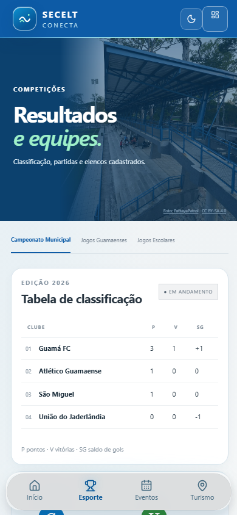

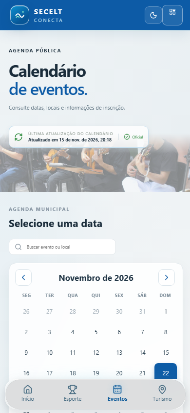

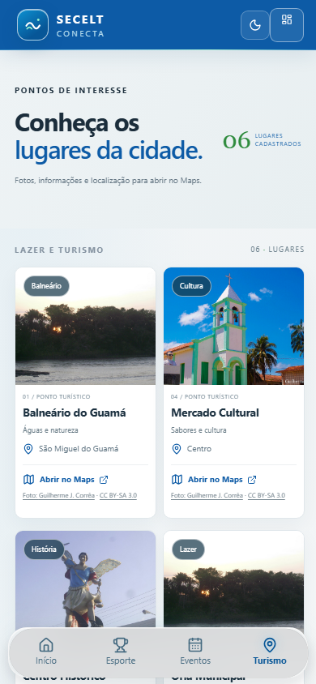

### Painel administrativo — tema claro

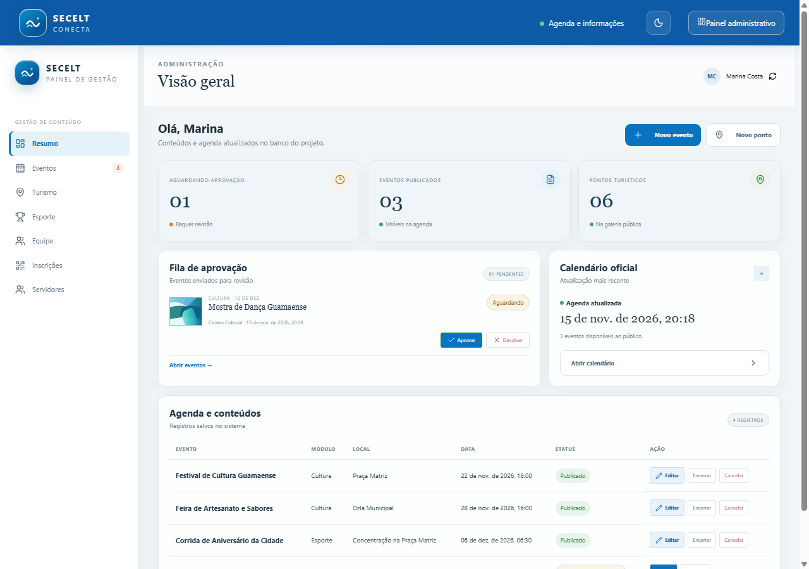

### Painel administrativo — tema escuro

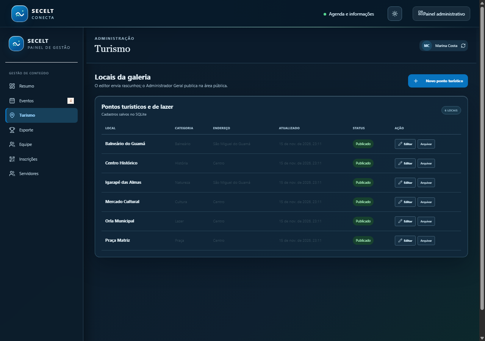

### Aplicativo Android — telas capturadas no emulador

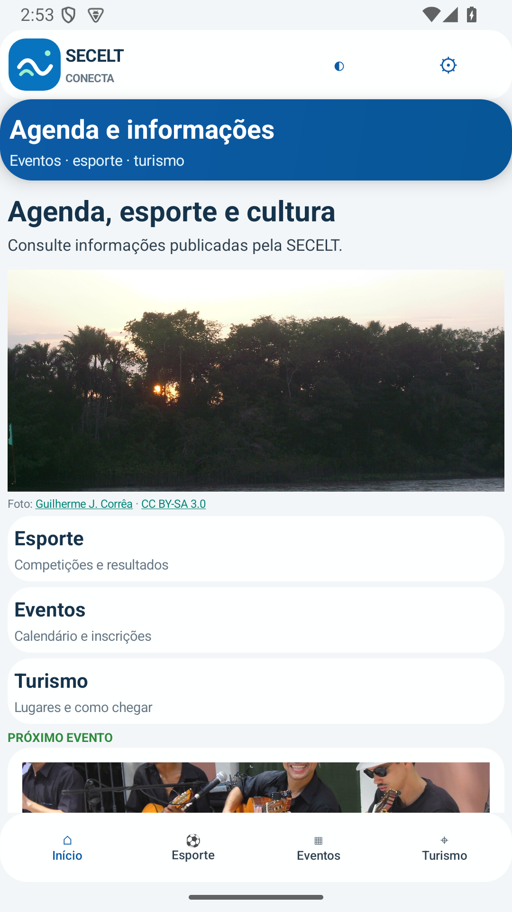

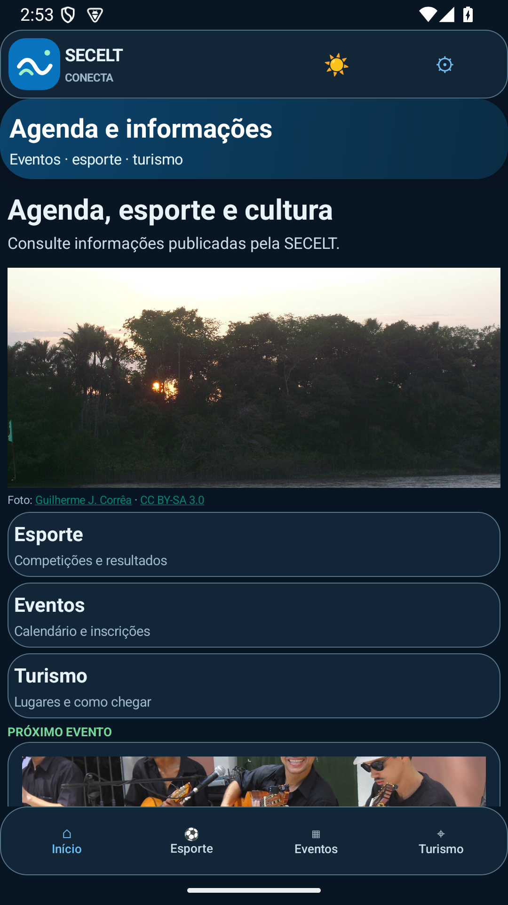

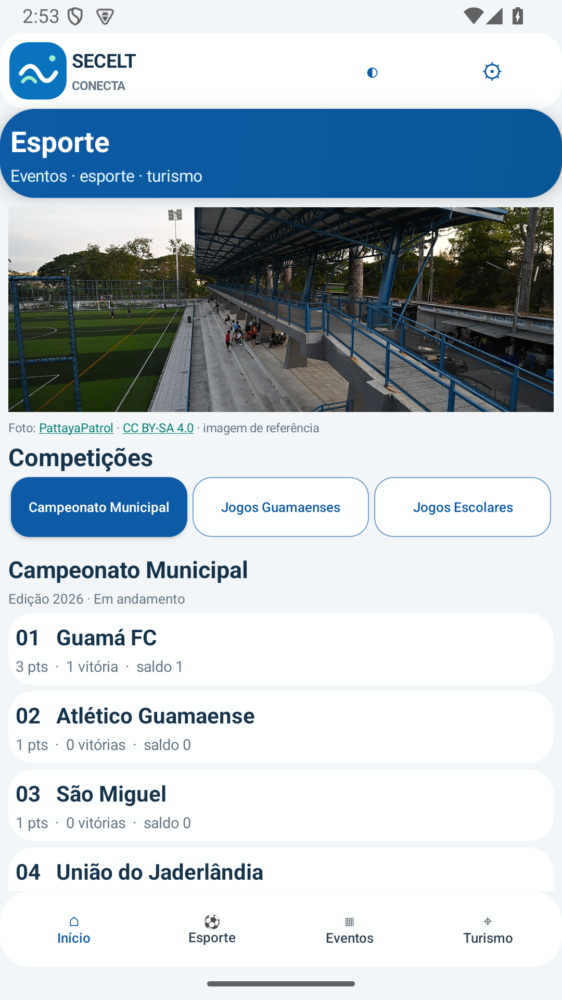

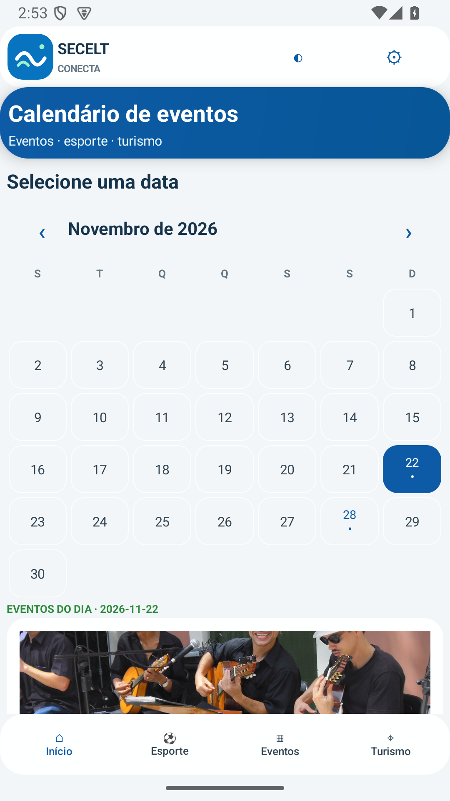

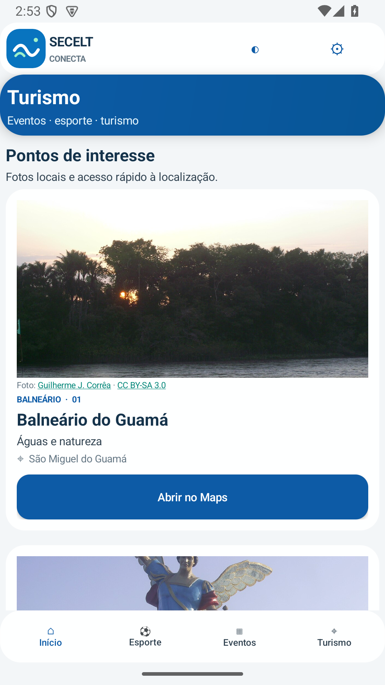

## Figuras vetoriais para apresentação

As telas abaixo são ilustrações de apresentação. A versão navegável mais atual é o site React.

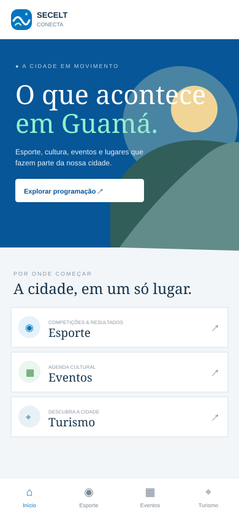

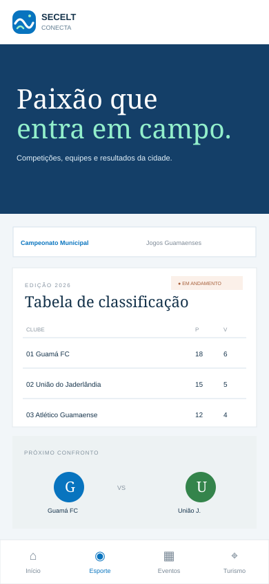


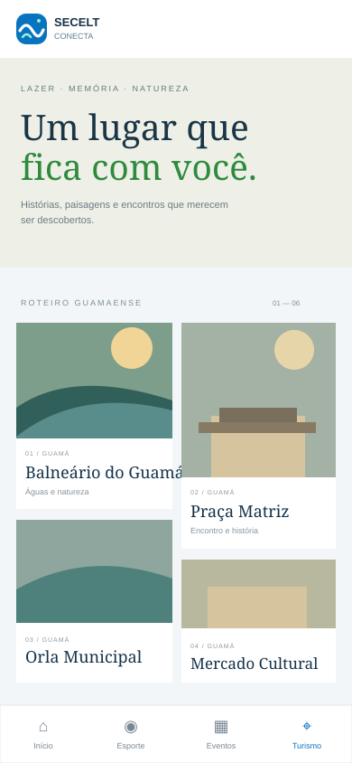

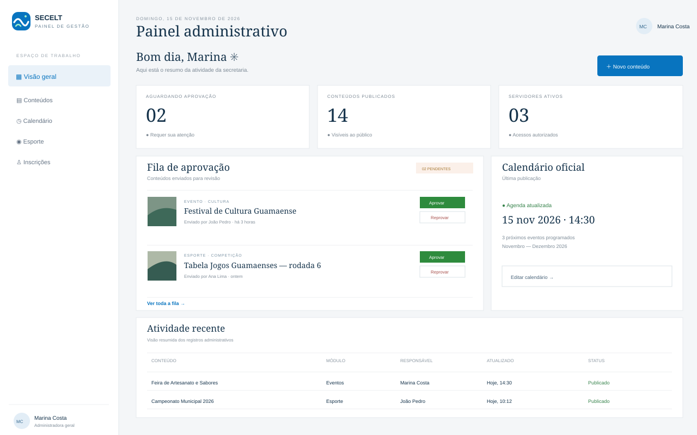

As fotografias locais são referências visuais licenciadas e estão identificadas na interface. Autoria, origem e licenças estão em [`assets/IMAGE_CREDITS.md`](assets/IMAGE_CREDITS.md).

O portal usa `@ybouane/liquidglass` para os reflexos e a refração WebGL. O app Kotlin oferece superfícies translúcidas e modo claro/escuro com preferência salva. Consulte [THIRD_PARTY_NOTICES.md](THIRD_PARTY_NOTICES.md) para os créditos e licença.

## Estrutura principal

- `web/src/main.jsx`: experiências públicas, painel administrativo, login, formulários e fluxos.
- `web/src/style.css`: identidade visual e comportamento responsivo.
- `server.js`: API, autenticação, regras de negócio e servidor do site.
- `data/`: banco SQLite local (ignorado pelo Git).
- `database/schema.sql`: esquema relacional de referência.
- `android/app/src/main/java/`: aplicativo Android nativo em Kotlin.
- `screenshots/`: figuras de apoio para apresentação do TCC.

## Limites desta versão

A instância SQLite persiste dados neste computador e serve para demonstração local; não sincroniza automaticamente entre instalações nem substitui uma implantação PostgreSQL/Supabase hospedada. Para apresentação em mais de um dispositivo, o app e o navegador precisam alcançar o mesmo computador servidor. A geração do QR Code e o check-in real dependem de operação institucional e validação no local.


